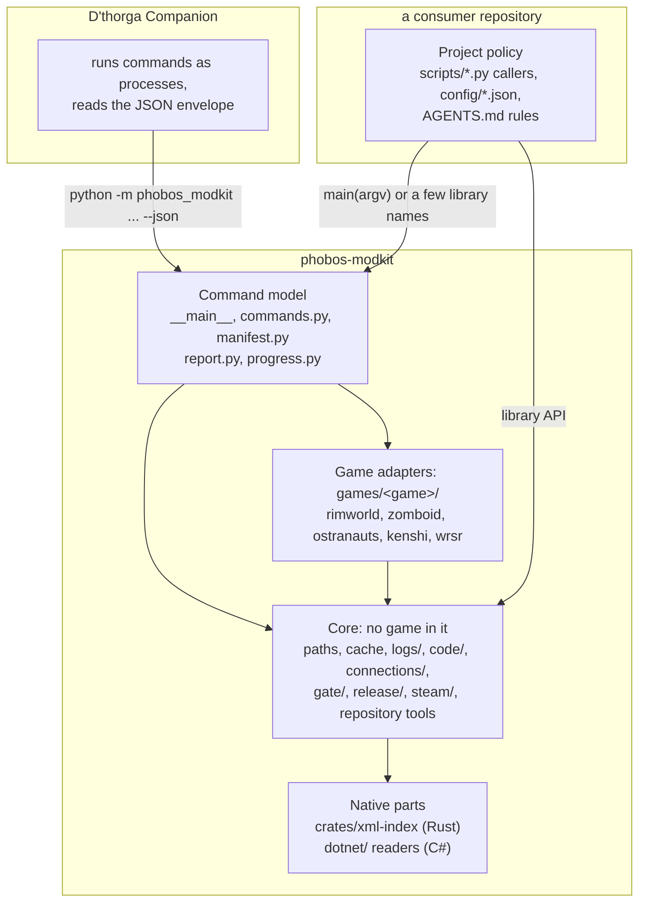
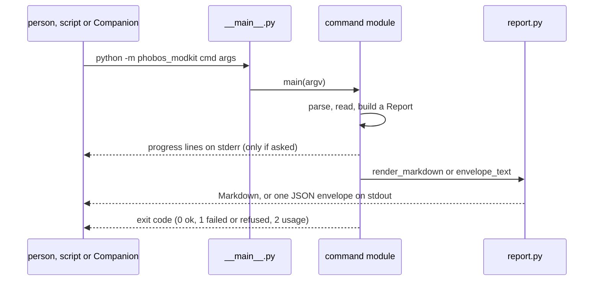

# Architecture: how the kit is built

**Status (23 Nov 2026, kit 1.108.1):** written fresh from the code in the docs rewrite, step 4, with the owner's go-ahead. It
replaces the layer tables, the languages and the frameworks table that `AGENTS.md` and [project direction](project-direction.md)
each carried. The rules stay in `AGENTS.md`; the decisions, and what was set aside, stay in project direction; what another
repository may import is in [library API](library-api.md).

**Answer first.** The kit is one Python package (`python/phobos_modkit`, standard library only) with 50 commands, each run as
`python -m phobos_modkit <command>`. Every command builds one `Report` and prints it as Markdown for a person or as one JSON
envelope for a program. Game knowledge lives in adapters under `games/<game>/`; everything else names no game. Two native parts
do what Python is too slow or too unsafe for: a Rust XML indexer (saves) and two C# readers (assembly metadata, a running game's
heap). All of them build outside the repository.

## Read this first (gotchas)

- **Run commands from `python/`** (`cd python && python -m phobos_modkit ...`), or put `python/` on the import path. A consumer
  repository does that with a small shim (phobos-rimworld's `scripts/_modkit.py`).
- **Core never names a game.** A command named `rimworld-...` is a RimWorld adapter's command; its game-free half sits in core
  (log triage in `logs/`, the save index's Rust reader, `code/`). Adding a game means adding data or an adapter, not editing core.
- **Nothing builds into the repository.** Rust and C# build into `%LOCALAPPDATA%\phobos-modkit\target` on Windows
  (`~/.cache/phobos-modkit/target` elsewhere). **Set `CARGO_TARGET_DIR` to it before any `cargo` command**: a cloud-synced clone
  otherwise uploads hundreds of megabytes (526 MB did on 7 Nov 2026).
- **Derived data lives in the kit's cache**, never in a repository: by default the system's temp folder, `phobos-modkit`.
- **A command's doc ends with a generated block**; change the parser's help, never the block (`command-docs --write`).
- **Consumers import a few modules directly.** Only the names in [library API](library-api.md) are a promise; anything else may
  change in any release.

## The three layers

| Layer | What it is | Where |
| --- | --- | --- |
| Core | Code with no game in it: paths and settings, the cache, log grouping, C# and assembly reading, the gate, release chores, Steam's public pages and the uploader, the repository tools | `python/phobos_modkit/` outside `games/`, `crates/`, `dotnet/` |
| Game adapter | Public file-format knowledge for one game, in our own words: log line formats, the save schema, mod metadata, load rules, where files live | `python/phobos_modkit/games/<game>/` |
| Project policy | What one project's mods require: which data matters, its own checks, its config files, its disclaimer text | the game repository |

The rules for each layer (core never names a game, adapters hold format facts in our own words, runtime mod libraries and in-game
recorders are out of scope) are in `AGENTS.md`, "What belongs here".

## Module map

### Command model and output

| Module | Holds |
| --- | --- |
| `__main__.py` | `python -m phobos_modkit <command>`: looks the command up in `commands.py`, imports only that module, calls its `main(argv)` |
| `commands.py` | `COMMANDS`: every command's module and one-line summary (50 on 23 Nov 2026: 34 core, 16 RimWorld) |
| `manifest.py` | The effects (`reads`, `reads-online`, `writes`, `runs`, `owner-press`, `owner-only`) and the `manifest` command, which reads each command's `MANIFEST` and parser |
| `report.py` | The report model (`Report`, `Section`, `Fact`, `Table`, `Bullets`, `Code`, `Chart`, `Globe`), redaction, `render_markdown`, `render_json`, `envelope_text` |
| `markdown.py`, `query.py` | Safe table cells; user wildcards and capped SQL for reports over SQLite indexes |
| `progress.py` | Progress lines on standard error, only when `PHOBOS_MODKIT_PROGRESS=1`; `run_streaming` passes a child's lines on |
| `command_docs.py`, `doc_tables.py`, `generated_blocks.py` | Generated blocks in docs: each command's reports and options, the README's index, and tables of a repository's projects, patches, mods and settings |

### Shared services

| Module | Holds |
| --- | --- |
| `paths.py` | The one path resolver (`resolve`, `where`), the central settings file, the cache root |
| `kit_settings.py`, `settings_cli.py` | Every setting the tools read, its value and which layer set it (the `settings` command) |
| `cache.py` | Derived data: the cache folder, provenance stamps, staleness, `frozen_copy`, removing read-only files |
| `files.py`, `textfile.py` | Link refusal, whole-tree reads, hashes, atomic writes; reading a file a program may still be writing |
| `file_lock.py`, `build_lock.py` | A lock shared between runs of the kit; one build at a time per repository |
| `game_folders.py`, `github.py` | Where games keep the player's files; GitHub read keyless, paced and cached |

### Game-free tool families

| Folder or modules | Holds |
| --- | --- |
| `logs/` | Log triage: entries, signatures, groups, run-to-run comparison, rendering. A game's adapter parses its own log |
| `code/` | The C# declaration scanner (`scan.py`), one SQLite index per source tree (`index.py`), build comparison, Harmony patches read from source |
| `connections/` | How a repository's code fits together, one reader per language: C#, XML Defs, Lua, Python, and each thing's git lineage; with a game named, the names between its data files and its code (`datanames.py`) |
| `data_names.py` | The names that cross between a game's data files and its code, read by a table of the game's adapter (`games/<game>/data-names.json`): things, rules, and the count every rule passes |
| `gate/` | A repository's checks from `config/gate.json`: runner, output parsers, the passing-run stamp the commit guard checks |
| `release/` | Changelogs in the Phobos form, version constants kept in step, the history screen before going public |
| `steam/` | Workshop research (`workshop.py`, cached and paced), the Steam client (`client.py`), BBCode, VDF; `publish/` for notes, staging, the owner's uploader and the per-game publishing data |
| `assemblies.py`, `assembly_refs.py`, `assembly_archive.py`, `targets.py` | Assembly metadata through the C# reader; every kept version of a project's dependencies; members named by string checked against metadata |
| `heap_reader.py`, `dotnet_diagnostics.py`, `dotnet_snapshots.py`, `sampling.py`, `process_memory.py` | Looking at a running .NET program from outside: heap snapshots, Microsoft's diagnostics tools, sampled stacks, memory over time |
| `crashdump.py`, `windows_dumps.py`, `zeroed.py` | Windows crash dumps; Windows' dump setting; files a crash left full of zeros |
| `mod_list.py`, `mod_lists.py`, `mod_runs.py`, `mod_sort.py`, `mod_settings.py` | A game's active-mod list checked, kept, compared and sorted; a mod's settings read from its source, through the adapter |
| `installs.py`, `install_checks.py`, `backup_archive.py` | A repository's installed mods, their records and zipped backups, and what moving between them changes |
| `changes.py`, `history.py`, `makeup.py`, `pins.py`, `repos.py` | The code behind a changelog entry; products over time; what a repository is made of; kit pins; each repository against its remote |
| `testpass.py`, `testpass_code.py`, `artaudit.py` | The in-game test list with its evidence and verdicts; every shipped image with its record |
| `checks.py` | Rules written as data that say when a game's saved or running state is wrong: a small safe language, judging and the report; adapters read the values ([checks](checks.md)) |
| `claims.py`, `decisions.py`, `picks.py`, `screen_notes.py` | The boards agent sessions and the owner share: claims, questions, picture and sound picks, notes on the Companion |
| `safe_copies.py`, `safe_copies_daily.py`, `records.py`, `cleanup.py`, `programs.py`, `feeds.py`, `issue_links.py`, `game_files.py`, `rules.py`, `source_clones.py` | Copies of what cannot be made again; leftovers; other programs; published feeds; where a fault is reported; what a game writes; the shared rules; lean clones of other authors' source |
| `games_list.py`, `mcp.py` | The owner's games list as D'thorga Companion keeps it; the reports that read, offered to AI programs over the Model Context Protocol |

A command's own module is usually `<name>_cli.py` (or `cli.py` in a folder) beside the module that does the work, so the work can
be tested and reused without the parser.

### Game adapters (`games/`)

| Game | Folder holds | What reads it |
| --- | --- | --- |
| RimWorld | 54 Python modules and three data files: log layouts, the save schema (`save-schema.toml`) and its reports, Defs and patches, mods and load rules, settings, Harmony patches, startup, readiness, textures, perf, the atlas, the mod list, mod settings from source, publishing data; and the 16 `rimworld-*` commands | Most of the kit |
| Project Zomboid (`zomboid`) | `mod_list.py` (its lists and `mod.info`), `workshop.json` | `mod-list`, `steam-publish` |
| Ostranauts | `workshop.json` (and a package marker) | `steam-publish` |
| Kenshi | `workshop.json` | `steam-publish` |
| Workers & Resources (`wrsr`) | `workshop.json` | `steam-publish` |

`games/__init__.py` finds them: `publish_adapters()` loads every `workshop.json` (Steam app ID to adapter), and `MOD_LIST_GAMES`
names the games whose active-mod lists `mod-list` reads. A generic adapter contract (`log --game X`) is not built yet; project
direction says why.

## The command model

- **Each command module has `main(argv=None, ..., out=None)`** and a `MANIFEST` beside its parser: its game (or `None`), the
  parser, its effect, and per-report notes, questions and surfaces. `tests/test_manifest.py` holds every command to it.
- **Effects are declared, not proven.** A program must still refuse an `owner-only` command; `owner-press` (the uploader) runs
  only on the person's own press. See [manifest](manifest.md).
- **The report model.** A `Report` has `facts`, opening `lines` and `blocks`, and `sections` of blocks: text, `Bullets`,
  `Table`, `Code`, `Chart` (bar or line, by role, never by colour) and `Globe` (a planet of tiles). Redaction (the home folder
  becomes `~`) reaches every string. A tool never hand-writes Markdown or `json.dumps` a report.
- **The JSON envelope**: `{"envelope": 1, "tool", "kit_version", "report", "data"}`. `data` carries anything of the tool's own.
  This is what D'thorga Companion reads; its shape is a promise ([manifest](manifest.md)).
- **Progress**: one JSON object per line on standard error, `{"progress": 1, "label", "step", "of", "detail"}`, only with
  `PHOBOS_MODKIT_PROGRESS=1`. Standard output stays the envelope alone.
- **Generated blocks** (`generated_blocks.py`): text between `<!-- generated: KEY -->` and `<!-- end generated -->`.
  `command-docs` writes each command's reports-and-options block and the README's command index from the manifest; `doc-tables`
  writes a repository's tables from its own files. Both keep a file's own line endings, and both fail their check when a block
  is out of date.

## Derived data

| What | Where | Rule |
| --- | --- | --- |
| Indexes, caches, fetched pages | `cache.folder(namespace)`, under `cache_root()`: `modkitCachePath` / `PHOBOS_MODKIT_CACHE`, default `<temp>/phobos-modkit` | SQLite with a `meta` table of provenance |
| Provenance | `meta` keys such as `source`, `source_size`, `source_mtime_ns`, `schema_sha`, `kit_version` | `cache.is_current` compares them; a mismatch rebuilds |
| A file another program is writing | `cache.frozen_copy(source, into)` | Copy first, then read the copy (saves, logs) |
| Archives that must outlive Steam updates | `rimworld-archive`'s store, outside the cache | Cleaning the cache never removes it |

Every derived file being SQLite means one question that crosses tools is one query, with `ATTACH`. The save index, the Def
index, the code index, the Workshop cache and perf traces all follow it.

## The native parts

| Part | Language | What it does | Builds |
| --- | --- | --- | --- |
| `crates/xml-index` | Rust, edition 2024, pinned toolchain (`rust-toolchain.toml`) | Streams a large XML file once into SQLite, driven by a schema file; RimWorld's is `games/rimworld/save-schema.toml`. Used by `rimworld-save` | `rimworld-save --build-indexer`, or `native.build_tools()`: `cargo build --release --locked` into `native.build_dir()` |
| `dotnet/PhobosModKit.Assemblies` | C#, .NET 10 | Reads assembly metadata with `System.Reflection.Metadata`, never loading an assembly: members, calls, Harmony attributes, references | On first use, by `dotnet_tools.DotnetTool`, into `build_dir()/dotnet/tool/<folder>/<kit version>` |
| `dotnet/PhobosModKit.Heap` | C#, .NET 10, with Microsoft ClrMD (the one package reference) | Reads a running game's heap from a Windows snapshot | The same way; loads only the game's own `mscordaccore.dll` |

- **Where a program is looked for** (`native.tool_path`): an explicit path; its environment variable (`PHOBOS_XML_INDEX`); a
  ready-built `tools` folder from an installer (`PHOBOS_MODKIT_TOOLS`); the build folder (`PHOBOS_MODKIT_BUILD` overrides it);
  then the repository's own `target/`.
- **C# builds are per kit version**, so two repositories pinning different versions never rebuild over each other (1.79.1).
  `dotnet/Directory.Build.props` sends `obj/` and `bin/` to the same build folder and keeps builds deterministic.

## Settings and paths

Every machine path comes from `paths.resolve(key, env_var, default, explicit, environ, settings_file)`, in one order:

1. an explicit argument (`--game`, `--cache`, ...);
2. the environment variable;
3. the repository's own settings file (phobos-rimworld's `.local/install-settings.json`), passed as `settings_file`;
4. the central settings file: `PHOBOS_SETTINGS`, else `settings.json` in D'thorga Companion's data folder;
5. the default.

`paths.where` says which layer won; `python -m phobos_modkit settings list` shows every setting that way. A game's paths
(`games/rimworld/paths.py`) are named keys on the same resolver. See [settings](settings.md).

## Tests and the gate

- **`tests/`** (89 test files), `unittest`, standard library only. `tests/support.py` puts `python/` on the path and points the
  history log and the central settings file at a folder of the run's own (`isolated_environ` adds the Companion's folder and the
  cache), so no test touches the owner's files.
- **Fixtures are hand-written** from format knowledge (`fixtures/`, described in `fixtures/README.md`). Network, clock and
  child processes are passed in, so tests never reach Steam.
- **The gate**: `cd python && python -m phobos_modkit gate --root ..` runs `config/gate.json`: `cargo fmt`, `clippy`, `test`,
  `build --release`; the Python tests on the current Python with `PHOBOS_REQUIRE_NATIVE=1` and on 3.10 through `uv`; and the
  `command-docs` check. It prints only what failed, and records the files a passing run saw.
- **The commit guard**: `.githooks/pre-commit` runs `gate --verify-staged`, refusing a commit whose staged files no passing run
  saw exactly. `git config core.hooksPath .githooks` after cloning.
- **CI** (`.github/workflows/verify.yml`) repeats the checks on Windows and Linux.

## Adding a command: checklist

1. **Decide the layer.** Game-free work goes in core; a game's format facts go in `games/<game>/`. A command for one game is
   named `<game>-<what>`.
2. **Write the work module and its `_cli.py`**: an argparse parser with `--json` and `--no-redact` on every report, and
   `main(argv=None, environ=None, out=None, ...)` that builds a `Report` and prints `render_markdown` or `envelope_text`.
   Pass the network, clock and child processes in as arguments, for tests.
3. **Declare a `MANIFEST`** beside the parser: game, parser, effect, and per-report `effect`, `when`, `note`, `question`,
   `surface` as needed.
4. **Add it to `commands.py`.**
5. **Paths through `paths.resolve`**, derived data through `cache`, filters through `query`, long work through `progress`.
6. **Write its doc** (`docs/<name>.md`, to [the tool page template](writing-a-tool-page.md)) and name it in `config/command-docs.json`; run
   `python -m phobos_modkit command-docs --write`.
7. **Tests with hand-written fixtures**, then the gate; a `CHANGELOG.md` entry (new command: the middle number) and the three
   version files.
8. **If a consumer will import it** rather than run it, add it to [library API](library-api.md) and
   `tests/test_library_api.py` in the same commit.

## How a consumer repository uses the kit

| Piece | How |
| --- | --- |
| The pin | A git submodule at `external/phobos-modkit`; moving to a newer kit is a commit that moves the pin. `git submodule update --init` after cloning |
| The shim | A few lines (phobos-rimworld's `scripts/_modkit.py`) that put `external/phobos-modkit/python` on `sys.path`, or say how to fetch the submodule |
| Thin callers | One `scripts/<name>.py` per tool, importing the command's `main` and calling it with the repository's own root and `settings_file`, so its people type one short command |
| Library calls | A few names imported directly (installs, textures, paths, progress): only those in [library API](library-api.md) |
| Its gate | `config/gate.json` in its own repository, run through the kit's `gate`; steps such as `rules check` and `doc-tables` |
| The rules | `CLAUDE.md` imports `external/phobos-modkit/rules/every-session.md`, and `AGENTS.md` points to it ([rules](../rules/README.md)) |
| A program | D'thorga Companion runs `python -m phobos_modkit <command> --json` as a process and reads the envelope; `manifest --json` tells it every command, report, option and effect. It imports nothing |

A fix lands in the kit first; the consumer then moves its pin. A consumer adopts a tool when it next touches the script it
replaces, not in a sweep.

## Shared frameworks inside the kit

Agreed with the owner on 7 November 2026, after two tools had shown what repeats (agent proposal, owner's go-ahead).

| Framework | Module | What it gives every tool |
| --- | --- | --- |
| Report model | `report.py` | One way to build a report and render it as Markdown or JSON, with redaction everywhere and table cut-offs stated |
| Derived-data cache | `cache.py` | The cache folder, provenance stamps and hashes, a staleness check, frozen copies, removal of read-only files |
| SQLite substrate | a convention (`AGENTS.md`, "Derived data") | Every derived file is SQLite with a `meta` table, so tools read one another's data with `ATTACH` |
| Command manifest and envelope | `manifest.py`, `report.envelope_text` | One JSON shape for every command, and a machine-readable list of commands (1.0.0) |
| Progress lines | `progress.py` | One way for a program to show a long command working (1.24.0) |
| Generated blocks | `generated_blocks.py` | Docs tables that cannot drift from the code (1.107.0) |

## Languages

| Language | Used for | Why |
| --- | --- | --- |
| Python, standard library, 3.10 or newer | The default: every command, every report | Small inputs; every Phobos repository already runs Python; nothing to install |
| Rust | The XML indexer behind the save index | A save of about 300 MB took 7.6 s a pass in Python; index once, query many needs a fast reader; one self-contained program |
| C# | The assembly metadata reader and the heap reader | .NET's `System.Reflection.Metadata` reads assemblies without loading them, which keeps the rule against running other authors' code; ClrMD reads a .NET heap from outside |

## Limits

- The module map is a snapshot of 23 Nov 2026; `commands.py` and `python -m phobos_modkit manifest` are the live list.
- The manifest covers the kit's commands only, not a consumer's own scripts.
- A game with only `workshop.json` (Ostranauts, Kenshi, Workers & Resources) can be published from, but none of its logs, saves
  or mod lists are read yet.
