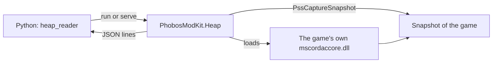

# The heap reader: looking inside a running game

Reads a Windows snapshot of a running game: every object by type with no limit on how many, any object's values, and why
something is still in memory, without forcing a collection. RimWorld's commands are part of [rimworld-perf](rimworld-perf.md).

## Read this first

- **It only reads.** It takes a Windows snapshot of the game, which pauses it for about half a second (431 to 470 ms on a RimWorld
  1.7 colony of 27 million objects, November 2026), then reads the snapshot while the game runs on. Nothing is written to the game.
- **Ask before every snapshot of someone's running game**, and ask them to save first, as for every tool that attaches to a game.
- **A snapshot does not sweep the heap first**, so its counts include garbage the collector has not reclaimed yet. `why` tells the
  two apart: a kind nothing holds is garbage, not a leak.
- **Addresses are good only within one snapshot.** The collector moves objects, so a command line that lists objects opens the first
  one in the same run (`--open`), and a program holds one snapshot (`serve`) while it follows links.
- **A held snapshot costs memory while the game runs on**: Windows copies each page the game changes after it. `serve` lets it go
  after ten minutes (the owner's choice, 20 November 2026), when its input closes, or on `{"op": "release"}`.
- **Windows only**, and only for a game on .NET (CoreCLR) whose install ships its memory-reading library (`mscordaccore.dll`).
- **A snapshot needs room** (1.132.0): Windows copies the game for it, which takes about the game's own private memory in free
  commit (RAM plus page file). When there is less, Windows refuses with error 1450 ("Could not create snapshot to process"), and the
  reader says so. **`--freeze`** (on `look-check`, and from 1.134.0 on `look` and `look-kind`) reads the game in place instead, with no copy: the game **stands still for the
  whole read** (28.6 s for the owner's game, 21.3 GB private, 27 November 2026), at most 120 s, then runs on. Only a command line's
  one run may freeze; `serve`, which holds its game while a page waits, never does.
- **A frozen game is always let go**: when the read is done, at its time limit, on Ctrl+C and when the reader ends. If the reader is
  stopped before it can (killed, or the machine's own trouble), the kit runs the reader's **`thaw`** at once: when every thread of
  the game is suspended, it resumes each once; when any thread runs, it changes nothing. If even that fails, the report says to close
  the game; the last save is safe. **`look-thaw`** (1.134.0) runs the same thaw by hand, for a game that still stands still.
- `look-why` never freezes: its paths may take five minutes, more than a frozen game's limit.

## Examples

```text
python -m phobos_modkit rimworld-perf look --label "day 40"        every object by type and by mod; kept beside the gcdump heaps
python -m phobos_modkit rimworld-perf look-kind Verse.Pawn --open   one kind's objects, each described, and the first in full
python -m phobos_modkit rimworld-perf look-why System.Xml.XmlDocument   why a kind is still in memory
python -m phobos_modkit rimworld-perf look-serve                    hold a snapshot; one JSON request a line on standard input
python -m phobos_modkit rimworld-perf look-check                    a repository's live checks, all from one snapshot
python -m phobos_modkit rimworld-perf look-check --freeze           the same, the game frozen and read in place (no room for a copy)
python -m phobos_modkit rimworld-perf look --freeze                 every object by type and by mod, read with the game frozen
python -m phobos_modkit rimworld-perf look-thaw                     a game a look inside left standing still runs on (only if it is)
```

## Outputs

### What each request answers

| Request | Answer |
| --- | --- |
| `overview` | Every type: its count, bytes and module; free space between objects; every object read, with no limit on how many |
| `kind` | One type's objects, each described in a few words, largest first on request, filtered by a word; `open` opens the first in full |
| `object` | One object with every value it holds: numbers, text, enums by name, structs opened, links to other objects described; .NET's lists, dictionaries and sets opened as their items |
| `holders` | The objects that point to it, and through which field or array slot; whether it is a root; the static field that holds it |
| `path` | One path from a root down to it, starting at the static field on the way when there is one |
| `why` | Paths from roots to a kind's largest objects (up to 2,000 checked), each to a different one; or that nothing holds them |
| `values` | Named paths read from every object of a kind (1.120.0, for [live checks](checks.md)): `{"op": "values", "type": NAME, "paths": [...]}`, with `take` (objects, default 5,000), `items` (items opened per path on one object, default 1,000) and `subclasses` (objects of kinds below it too). Each object gives its address, summary and a value for each path; `more` says objects were left out, and an object's `cut` that a list was |

**A values path** follows fields by name, joined by dots, through links and structs (`parent.def.defName`, `Position.Z`). `[]`
after a name opens a list, array, set or dictionary into its items (a dictionary's values), and the rest of the path is read from
each item (`Members[].Name`); a final `#` gives a collection's count without reading its items (`Members#`). A path that opened
anything answers with a list; one that did not, with one value or null (a null link on the way, or a field the object's kind does
not have). Values come as text, as `object` gives them (an enum as its name and number); a link at the end gives its summary. A
struct at the end gives null: name one of its fields.

**`look-serve` answers `{"op": "checks"}` too** (1.123.0): every live check in the game's check files ([checks](checks.md)),
asked of the snapshot it already holds, so a program's "run the checks" button takes no second snapshot. Its data is the check
data (`checks`, `faults`, `looks`) with the report itself under `report`, as `render_json` gives it.

`look` keeps its overview as a heap in `rimworld-heaps/`, so `heap-report` reads it again and `heap-compare` sets it beside another
`look` or a gcdump heap (mind that a gcdump forces a collection first and a snapshot does not). `look-serve` is for a program's page
(the manifest's `look-inside` surface): its first line says whether the snapshot was taken, each request may carry an `id` its
answer repeats, and an overview's answer gains who each type belongs to.

- **How objects are described** is the game adapter's: a list of field paths (`def.defName`, `nameInt.nickInt`), of which the
  first two the reader finds are shown. RimWorld's are in `games/rimworld/look.py`.
- **Progress** comes as the kit's progress lines on standard error when `PHOBOS_MODKIT_PROGRESS` is set: walking every object takes
  about 12 to 18 s on a large colony; a path from the roots can take a few minutes, and gives up after five.
- **The first real use** (20 November 2026, the owner's colony): 453 MB of XML in 9.8 million objects was live, held through every
  mod's `ModContentPack.patches`, which the game clears after loading and Vanilla Expanded Framework's settings code reads again
  (each read makes the game load every patch file again, and keep it). A finding for phobos-rimworld, recorded there.

## Effects

### How it works



- **The reader** is `dotnet/PhobosModKit.Heap`, built into the kit's build folder on first use like the assembly reader
  (`dotnet_tools`), or brought ready-built by an installer (`programs bundle`). It uses Microsoft's ClrMD
  ([dotnet/clrmd](https://github.com/microsoft/clrmd), MIT), the kit's one C# package (owner's yes, 20 November 2026).
- **Which memory-reading library it loads.** A program's .NET runtime ships one library that knows its memory layout. The caller
  (a game's adapter) names the install it trusts; the reader refuses a program whose `coreclr.dll` is anywhere else, and loads only
  the library beside it. RimWorld 1.7 ships its own build of .NET (Waylith, Ludeon's engine), whose library is not signed by
  Microsoft, so the signature check is off and the folder check is what stands in for it. This loads the game's own runtime code
  into the reader; it is the one exception to "never execute other authors' code" (`AGENTS.md`, owner's yes, 20 November 2026), and
  never extends to a mod's file.

## Limits

- Structs are opened two levels deep; text is cut at 4,000 characters, descriptions at 120.
- A field Waylith adds at run time (its field injection) shows only where the runtime's own metadata lists it; not yet checked on
  every type.
- Memory outside .NET's heap (textures, the engine's own) is not in a snapshot's answers: rimworld-perf's `watch` sees it.
