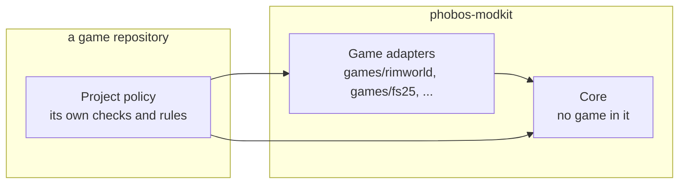

# Project direction (7 Nov 2026)

**Answer first.** Phobos ModKit is one home for out-of-game modding tools that are not specific to one
project: reading logs, saves, mod data, assemblies and Workshop pages, and the release chores every mod
repository repeats. It exists so that agent sessions read short, deterministic summaries instead of large
files, and so the owner's game repositories stop carrying drifting copies of the same scripts.

**Who decided what.** Owner (7 Nov 2026): build deterministic tools to save LLM work; put truly generic
code in its own repository; this name; public under MIT. Agent choices, open to revision: the three layers,
game adapters living here, the tool list and order, and the language of each tool.

## The three layers

- **Core** holds code with no game in it: path resolution and Steam library discovery, Steam's public
  Workshop pages and API, log grouping and run-to-run comparison, streaming XML indexing, assembly metadata,
  changelog, release-note and link checking, and the install pattern (refuse while running, back up first).
- **Game adapters** hold public file-format knowledge for one game: its log line formats, its save schema,
  its mod metadata files and load rules. Anyone modding that game can use them without the owner's mods.
- **Project policy** stays in each game repository: which data matters to its mods, its own checks, its
  disclaimer text, its mod suggestions.

Why adapters live here and not in the game repositories (agent choice): the format knowledge is the part
most worth sharing, and keeping it beside the core keeps the core honest about what it must not know.

## Out of scope

- **Runtime mod libraries**, which run inside a game: D'thorga Framework (RimWorld), PhobosLib (Project
  Zomboid), FS25_PhobosLib, Phobos Framework (Ostranauts). They stay in their own repositories.
- **In-game profiling**, which is [Phobos Scope](https://github.com/phobos-dthorga/phobos-scope)'s.
- **Steam uploads.** Owner-run upload scripts stay in the repository that publishes.

## Languages

| Language | Used for | Why |
| --- | --- | --- |
| Python, standard library | The default: logs, mod data, Workshop, release tooling | Small inputs; every Phobos repository already runs Python; no toolchain to install |
| Rust | The save indexer | Saves of about 300 MB are read on every question in Python (7.6 s per pass on a high-end PC); index once, query many needs a fast reader; one self-contained program |
| C# | The assembly metadata reader | .NET's `System.Reflection.Metadata` reads assemblies without loading them, which keeps the rule against running other authors' code |

## How consumers use it

- A pinned git submodule at `external/phobos-modkit`, as phobos-ostranauts pins Phobos Scope.
- Python scripts add `external/phobos-modkit/python` to their import path through a few-line shim.
- The Rust and C# tools are built from the submodule by the consumer's own build or verify script; their
  programs are ignored.
- A fix lands here first, then the consumer moves its pin. Consumers adopt a tool when they next touch the
  script it replaces.

## Order of work

The first consumer is phobos-rimworld; its
[analysis tooling record](https://github.com/phobos-dthorga/phobos-rimworld/blob/main/docs/development/analysis-tooling.md)
gives each tool's design.

1. These documents. Done 7 Nov 2026.
2. Log triage, core and RimWorld adapter.
3. The save indexer's working slice, with RimWorld's schema.
4. RimWorld's mod and Def index.
5. The assembly metadata reader, Workshop research, startup sessions, the readiness scan and release
   tooling, as the need arises.

Continuous integration arrives with the first tool, running its tests on Windows and Linux as Phobos Scope does.
