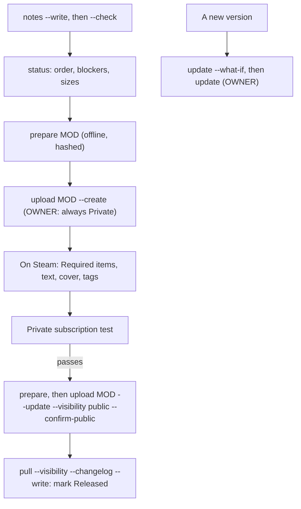

# Steam Workshop publishing: taking a repository's mods to the Workshop

`steam-publish` turns each mod's changelog into Steam change notes, checks the Workshop page, stages a hashed candidate offline,
uploads it when the owner runs it, records what went up, and brings Steam's live state back. It came from phobos-ostranauts'
publishing scripts (owner's request, 8 November 2026), made to work for any game with an adapter: RimWorld and Ostranauts so far.

## Read this first

- **Only the owner uploads**, in their own console or by their own press in D'thorga Companion. `upload` and `update`
  send through the **Steam client** already running and signed in (`--via steam`, the default), or through
  **SteamCMD** (`--via steamcmd`), which asks for the Steam password and Steam Guard code in its own prompt. The tool never
  sees, stores or passes them. Agents, tests and CI never run a real upload.
  Every other command is offline or reads Steam's public API without a key.
- **New items are always created Private.** Test a private subscription, then update with `--visibility public
  --confirm-public`. Anything wider than Private needs a candidate prepared from committed work.
- **Never retry a create blindly.** If SteamCMD returns no item ID, check your Workshop items on Steam first, then
  `reconcile` the receipt with `--item-id` or `--not-created`. The tool refuses a second create until you do.
- **SteamCMD cannot set Required items; the Steam client route does.** Add them on the item's page (Owner controls, Add/Remove Required Items);
  the uploader prints the list.
- **SteamCMD sets no tags; the Steam client route sets the game file's tags.** RimWorld's own uploader tags an item "Mod" and with each game version (such as
  1.7); after a SteamCMD upload, check the tags. Source: a
  [Ludeon forum report](https://ludeon.com/forums/index.php?msg=337218), not checked against Valve's documentation.
- **RimWorld: About/PublishedFileId.txt must agree with the catalogue.** The game's own uploader writes it; the tool
  writes it too when it records a new item, and refuses to work while the two disagree, so one mod never becomes
  two items.
- **Workshop text may not hold ASCII double quotes or backslashes.** It travels inside a SteamCMD file whose escapes
  Valve does not document. Changelog quotes become typographic ones; pages must use them already.
- **Pages stay under 7,500 bytes** (our headroom; Steam's limit is 8,000), and a change note longer than Steam's
  limit drops its oldest versions and names them in a closing line.
- **Not tested against Steam from this kit yet.** The logic was carried over from phobos-ostranauts, whose
  PowerShell uploader (asked for by the owner on 29 September 2026) put its ten items on the Workshop, and checked
  against that repository's records (see [Checked](#checked)). The Python uploader itself has run only against a
  stand-in for SteamCMD.

## Examples

Run from the repository, or pass `--root`. A game repository normally calls these through a thin wrapper script.

```text
python -m phobos_modkit steam-publish notes --check           release notes current? pages valid?
python -m phobos_modkit steam-publish notes --write           write workshop/<Mod>/releases/<version>.bbcode
python -m phobos_modkit steam-publish notes --check --base origin/main   content changes came with their records?
python -m phobos_modkit steam-publish status                  every mod: package, blockers, sizes, order
python -m phobos_modkit steam-publish pending                 which items have a newer version than uploaded
python -m phobos_modkit steam-publish prepare Framework [--build]
python -m phobos_modkit steam-publish verify <candidate folder>
python -m phobos_modkit steam-publish upload Framework --create [--what-if]          OWNER ONLY
python -m phobos_modkit steam-publish upload Framework --update [--visibility public --confirm-public]
python -m phobos_modkit steam-publish update [--what-if] [--no-build] [--acknowledge-hold]   OWNER ONLY
python -m phobos_modkit steam-publish reconcile <receipt folder> --item-id 123 | --not-created
python -m phobos_modkit steam-publish pull [--visibility] [--description] [--changelog] [--write]
python -m phobos_modkit steam-publish change-notes [--no-write]
python -m phobos_modkit steam-publish page Framework [--check|--write] [--stdin|--from FILE]
python -m phobos_modkit steam-publish show Framework
```

Mods are named in full or by a unique ending, ignoring case: `Framework` for `PhobosFramework`. `--json` gives JSON
([common options](common-options.md)).

### The flow



## Reports and options

<!-- generated: options steam-publish -->
Generated from the command's own parser by `python -m phobos_modkit command-docs --write`: change a help text in the parser, not here.

| Report | What it does | Effect |
| --- | --- | --- |
| `notes` | Check or write per-version change notes from changelogs. | writes, with `--write` |
| `status` | Every mod's package, blockers, sizes and publication order. | reads only |
| `pending` | Which items have a newer version than the one uploaded. | reads only |
| `prepare` | Stage a checked candidate for one mod, offline. Stages a candidate in the kit's cache. | runs other programs, with `--build` |
| `verify` | Re-check a staged candidate's files. | reads only |
| `upload` | OWNER ONLY: send one candidate to Steam. Only on the owner's press or in their own console; never an agent. | only on the owner's own press |
| `update` | OWNER ONLY: build, prepare and update every due item. Only on the owner's press or in their own console; never an agent. | only on the owner's own press |
| `reconcile` | Settle an uncertain upload's receipt. Settles an upload's receipt. | writes |
| `pull` | Bring Steam's live visibility, page and release dates back. Reads Steam. | writes, with `--write` |
| `page` | A mod's Workshop page with its problems; check or save a new text. Writes only the page file, only without problems. | writes, with `--write` |
| `show` | One mod's card: next change note, tags, Required items, receipts. | reads only |
| `change-notes` | Worksheets for tidying each item's Change Notes tab. `--no-write` only counts. | writes |

| Option | Reports | What it does | Default |
| --- | --- | --- | --- |
| `--root VALUE` | all | the repository (default: the current folder) |  |
| `--catalogue VALUE` | all | the Workshop catalogue, relative to the root (default config/workshop-publishing.json) |  |
| `--cache VALUE` | all | the kit's cache folder, where candidates are staged (else PHOBOS_MODKIT_CACHE, settings, temp) |  |
| `--settings VALUE` | all | a JSON settings file with modkitCachePath |  |
| `MODS ...` | `notes`, `update`, `pull`, `change-notes` | (optional) the mods, in full or by a unique ending (none named: every one it applies to) |  |
| `--version VALUE` | `notes` | one version only (needs one mod) |  |
| `--base VALUE` | `notes` | also require changelog and page edits for content changed since this commit |  |
| `--check` | `notes` | fail when generated files are missing or stale |  |
| `--write` | `notes` | write missing or stale files |  |
| `MOD` | `prepare`, `upload`, `page`, `show` | the mod, in full or by a unique ending (Framework for PhobosFramework) |  |
| `--build` | `prepare` | run the catalogue's build command first |  |
| `CANDIDATE` | `verify` | the staged candidate's folder |  |
| `--create` | `upload` | a new item (always private) |  |
| `--update` | `upload` | the mod's existing item |  |
| `--visibility VALUE` | `upload` | default: private, or the recorded one. One of `friends`, `friendsonly`, `private`, `public`, `unlisted`. |  |
| `--candidate VALUE` | `upload` | a staged candidate folder (default: the newest) |  |
| `--confirm-public` | `upload` | needed the first time an item goes public |  |
| `--force` | `upload` | send a version already on Steam again |  |
| `--via VALUE` | `upload`, `update` | steam: the running, signed-in Steam client (default); steamcmd: Valve's SteamCMD | `steam` |
| `--steam-library VALUE` | `upload`, `update` | the game's steam_api library, when it cannot be found; remembered locally |  |
| `--new-console` | `upload`, `update` | SteamCMD in a console window of its own (for a program) |  |
| `--steam-user VALUE` | `upload`, `update` | SteamCMD: the Steam account name, remembered locally; never a password |  |
| `--steamcmd VALUE` | `upload`, `update` | SteamCMD: its program, remembered locally |  |
| `--acknowledge-hold` | `upload`, `update` | private only: pass holds and unpublished dependencies |  |
| `--what-if` | `upload`, `update` | show the plan; write nothing and never ask Steam |  |
| `--no-build` | `update` | stage what is already built |  |
| `RECEIPT` | `reconcile` | the upload's receipt folder |  |
| `--item-id VALUE` | `reconcile` | the item Steam shows |  |
| `--not-created` | `reconcile` | Steam shows no such item |  |
| `--visibility` | `pull` | bring back the item's visibility; without any of the three, only report |  |
| `--description` | `pull` | bring back the item's description; without any of the three, only report |  |
| `--changelog` | `pull` | bring back the item's changelog; without any of the three, only report |  |
| `--write` | `pull` | apply; default only reports |  |
| `--check` | `page` | check the text given, without writing |  |
| `--write` | `page` | save the text given, only when it has no problems |  |
| `--stdin` | `page` | the text, as UTF-8 on standard input |  |
| `--from VALUE` | `page` | the text, from a file |  |
| `--no-write` | `change-notes` | only count entries |  |

- Every report also takes `--json` (print JSON instead of Markdown) and `--no-redact` (show the home folder instead of ~).
- Names in capitals are given bare, without a flag, in the order shown.
- A path left out is looked for in the order [settings](settings.md) explains: an environment variable, the repository's own settings file, the central settings file, then the default.
- [Common options](common-options.md) explains `--root`, `--settings`, `--cache`, `--json` and `--no-redact`, which many commands share.
- Only one of `--check`, `--write` at a time (`notes`, `page`).
- Only one of `--create`, `--update` at a time (`upload`).
- Only one of `--item-id`, `--not-created` at a time (`reconcile`).
- Only one of `--stdin`, `--from` at a time (`page`).
<!-- end generated -->

## Inputs

### The catalogue

`config/workshop-publishing.json` lists every mod; the tool refuses a catalogue that misses one.

```json
{
  "appId": "294100",
  "layout": {"exclude": ["*.record.md"], "build": ["python", "scripts/deploy.py", "--build"]},
  "mods": {
    "PhobosFramework": {"itemId": null, "requires": [], "hold": null},
    "PhobosMedical": {"itemId": "3900000000", "requires": ["PhobosFramework"],
                      "hold": "Held: awaiting play checks", "uploadedVersion": "0.7.0", "uploadedVisibility": "private"}
  },
  "externalRequiredItems": ["1000000001"],
  "externalRequiredItemNames": {"1000000001": "Someone's loader (a made-up example)"}
}
```

`appId` chooses the game adapter. `itemId`, `uploadedVersion` and `uploadedVisibility` are written by the tools from
what Steam returned; never invent one. A mod may carry its own `build` command.

| Layout key | Default | What it is |
| --- | --- | --- |
| `mod` | `mods/{mod}` | The mod's source folder; the adapter reads its metadata there |
| `changelog` | `mods/{mod}/CHANGELOG.md` | |
| `page` | `workshop/{mod}/page.bbcode` | The Workshop description |
| `releases` | `workshop/{mod}/releases` | Generated change notes |
| `content` | `mods/{mod}` | The folder uploaded, unless the repository passes its own payload |
| `exclude` | none | Globs left out of the content, by path or file name |
| `preview` | the adapter's | The cover, inside the content |
| `textFolder` | none | A content folder to carry the page and change note (Ostranauts used `documentation`) |
| `scope` | `mods/{mod}/` | Changes here need changelog and page edits (`notes --base`) |
| `dirtyExempt` | none | Folders whose uncommitted changes do not block a wider upload; the catalogue always is |
| `receipts`, `settings`, `worksheets` | under `.local/` | Owner records; keep receipts |
| `staging` | the kit's cache | Where candidates go |
| `pageMaxBytes`, `previewMaxBytes` | 7,500 and 1,000,000 | Our budgets, not Valve figures |
| `pageRules` | all on | `title`, `version`, `status` lines required on the page |
| `build` | none | A command run before preparing, `{mod}` replaced |
| `payloadHook` | none | `"scripts/file.py:function"` inside the repository: builds the item's files |
| `contentPrefix`, `previewSource` | none | A folder in the item the content goes under; the cover's file when it is not in the content |

### Release notes

Changelogs follow the [Phobos form](release.md#changelogs): an Unreleased section, then
`## [1.2.0] - 2026-11-08 - Draft` or `Released` entries. Each entry becomes
`[h1]<title> <version>[/h1]`, a status line and its body in BBCode. The Markdown kept is paragraphs, dash (`-`) bullets
(hard-wrapped lines join them), `###` headings, `**bold**` and `[label](https://...)` links; anything else is
refused rather than lost. Generated files are never edited by hand.

A page needs `[h1]<title>[/h1]`, one `[b]Version:[/b] <version>` line and a `[b]Publication status:[/b] ...` line
(each can be switched off with `pageRules`). `--base <commit>` also refuses content changed since that commit without
both a changelog and a page edit.

### Games, as data

**Each game is a small data file, `python/phobos_modkit/games/<game>/workshop.json`** (the owner, 23 November 2026:
"The Steam Workshop uploader should be genericized as far as is possible"). The core never names a game; the file says where a
mod keeps what Steam needs. A repository whose game has no file describes it in its catalogue instead, as a `game` block of the
same shape. `steam/publish/game_data.py` reads both.

| Game | App | Title and version | Cover | Tags | The game's ID file |
| --- | --- | --- | --- | --- | --- |
| RimWorld | 294100 | `About/About.xml` `<name>`, `<modVersion>` | `About/Preview.png` | `Mod`, then each `<supportedVersions><li>` | `About/PublishedFileId.txt` |
| Ostranauts | 1022980 | `mod_info.json` `0.strName`, `0.strModVersion` | `preview.png` | none | none |
| Project Zomboid | 108600 | The highest version folder's `mod.info` (`42.15/mod.info`) `name=`, `modversion=` | `preview.png`, a square PNG of 256 or 512 px, at most 1,024,000 bytes | `Build 42` | none (the catalogue) |
| Kenshi | 233860 | The catalogue (title defaults to the folder name); `<mod>.mod` marks the folder | `_<mod>.img` | the catalogue's | `_<mod>.info` `<id>`, when the game's tool made it |
| Workers & Resources | 784150 | `workshopconfig.ini` `$ITEM_NAME`; version from the catalogue | `previewimage.png` | none (the game's own are numbers) | `workshopconfig.ini` `$ITEM_ID`, before `$END` |

**Project Zomboid** suits a repository holding one mod at its top (`"mod": "."`, the game file's default): the item
is built as the game's own uploader builds it, the repository under `Contents/mods/<mod>/` and the cover from
`workshop/preview.png`, with dot files, `workshop/`, `docs/`, `scripts/` and `tests/` left out. It refuses what the game's
uploader refuses (`.exe`, `.dll`, `.zip` and the like) and ends the page with `Workshop ID:` and `Mod ID:` lines, which players
and servers use. **Kenshi and Workers & Resources** keep no release number the tools can read (Kenshi's `.mod` counts saves;
Workers & Resources has none), so each mod's catalogue entry gives its `version`. Their facts, with sources, are in their game
files; Workers & Resources' visibility numbers and tag names, and Kenshi's full tag list, were not found.

| Key | What it says |
| --- | --- |
| `appId`, `name`, `title` | The Steam app number, a short name, and the game's name for people |
| `metadata` | `file` (relative to the mod folder, any letter case, `{mod}` allowed), `format` and the `title` and `version` fields |
| `preview` | The cover, relative to the uploaded folder |
| `tags` | `fixed` tags, then each `fields` value; a catalogue entry's own `tags` are added |
| `required` | Each mod's own Required items from its metadata: `each` element with its `number` and `name` children (XML), or `fields` and `names`; a catalogue entry's `requiredItems` are added |
| `previewRules`, `refuse` | The game's cover rules (`format` png, `square`, `sizes`, `maxBytes`) and file endings its uploader refuses: blockers |
| `footer` | Lines ending the page as the game's uploader ends it; `{itemId}` and `{field:<name>}` filled in when sending |
| `idFile` | Where the game writes the item number: `file` and `format` (`text`, or `keyvalue` with `key` and `separator`) |
| `layout` | The game's own defaults for the catalogue's layout keys; the catalogue still wins |
| `reminders` | What the owner must still do on Steam afterwards |
| `facts` | The format facts, in our own words, with their sources |
| `hook` | Only where data cannot say it: a module beside the file (`.hook`) whose `read(adapter, folder, item)` gives the title and version |

| Metadata format | A field is |
| --- | --- |
| `xml` | Child elements from the root joined by `/`, any letter case (`supportedVersions/li`); bare `&` forgiven |
| `json` | Keys and list positions joined by `.` (`0.strName`) |
| `keyvalue` | A key on `key=value` lines (`separator` changes `=`; a space splits at the first space); a repeated key gives several values; `quoted` strips double quotes |
| `catalogue` | The mod's own catalogue entry (`title`, `version`, `tags`), for mods with no such file; the title defaults to the folder name |

In any format a field written `catalogue:<key>` comes from the catalogue entry. A metadata `file` may hold `*`; with `"pick":
"highest"` the match in the highest version-numbered folder wins, and `fallback` names a file for when nothing matches. ID files
may also be `xmltag` (one element's text, kept only in a file the game made). A catalogue's `layout` may set `"mod": "."` for a
repository of one mod, `contentPrefix` (a folder in the item the content goes under) and `previewSource` (the cover's file in
the repository). Mod names may hold single spaces.

A game with no file at all, described only by a catalogue block with `"metadata": {"format": "catalogue"}`, uploads its folder as
it is, with the title and version the catalogue gives. Moving RimWorld and Ostranauts to files changed nothing they read: the
titles and versions of all 18 mods in phobos-rimworld and phobos-ostranauts came out the same (23 November 2026), and every
candidate now records its `tags`.

What a package must hold beyond its folder is the repository's policy, not the game's format. **Name it in the catalogue**
(`"layout": {"payloadHook": "scripts/workshop_payload.py:payload"}`), so every runner, a console or D'thorga
Companion, builds the same package; the file must be inside the repository, and is loaded as the repository's own wrapper would
run it. A wrapper may still pass one in, which wins. A wrapper passes it as
a payload hook, `payload(project, mod) -> {relative path: bytes}`, which may also raise on a stale build:

```python
from phobos_modkit.steam.publish.cli import main
sys.exit(main(root=ROOT, settings_file=SETTINGS, payload=my_package_checks))
```

### Adopting it

- **phobos-rimworld:** its AGENTS.md adopts publication tooling in the change that prepares the first mod for its
  public beta gate, not before. Then: a catalogue with `"appId": "294100"`, a `workshop/<Mod>/page.bbcode` per mod, a
  wrapper script, `exclude` for files that should not ship (asset records), and a rule in its AGENTS.md. Its
  changelogs already pass `release changelog`, except one bracket in D'thorga Factory Additions 0.11.0 (8 November 2026).
- **phobos-ostranauts:** when it next touches its publishing scripts. Its catalogue needs `layout` entries to keep
  its behaviour: `scope` of `src/{mod}/`, `mods/{mod}/` and `translations/{mod}/`; `dirtyExempt` of `docs/research/`
  and `docs/development/`; `textFolder` of `documentation`; and its package checks (the `dist/` package, plugin DLLs
  against compiled output, read-only data headers, sounds, translations) as a payload hook. See
  [migration](migration.md) for every difference.

## Outputs

### Preparing

`prepare` runs every check, then writes a fresh folder (older ones are kept) holding `content/` (what the item will
hold), the page and change note, `workshop.vdf.draft` and `manifest.json` with each file's SHA-256 hash, the version,
commit, blockers and text sizes. Candidates live in the kit's cache folder, outside a cloud-synced repository.

Blockers: a catalogue `hold`, a missing or oversized cover, and a dependency with no item yet. A Private upload with
`--acknowledge-hold` may pass a hold or an unpublished dependency, for the owner's own test; a missing cover never.

The change note holds every changelog version after the item's `uploadedVersion`, newest first, so versions never
uploaded on their own still reach players. A first upload carries its own version only.

### For a program's Publish page

`page` and `show` are what D'thorga Companion's Publish page reads and writes; with `--json`, the envelope's `data`
holds everything it shows, and `status` and `pending` carry their rows there too.

- **`page MOD`** gives the page's text, its path, whether it exists (a missing page is offered as a starter with the three
  required lines, never written), its size against the budget, and **every problem at once**: unknown or unbalanced tags,
  ASCII quotes or backslashes, size, and the title, version and status lines. **`--check`** checks a text given on standard
  input (`--stdin`) or in a file (`--from`) and fails when it has problems; **`--write`** saves it, only when it has none, with
  LF line endings. Release notes are not rewritten by saving a page.
- **`show MOD`** gives one mod's card: title, version, tags, what the next upload would be, blockers, sizes, the Required
  items it would set, **the change note exactly as Steam would get it**, the item and what was last sent, whether an update is
  due, the game's reminders, and every receipt, newest first. A mod that is not ready says why in `error` and shows the rest.

**Every answer a program reads carries data** (the shapes the Companion's Publish page asked for): a refusal is
`{"ok": false, "refusal", "lines"}`; `upload --json` and `update --json` put what the uploader says in the report and give
`{"ok", "receipt", "itemId", "status", "lines"}` (`update` adds `updated`; a what-if adds `whatIf`), where `ok` means nothing
was due, a what-if, or a receipt whose sender said the files went up (still not proof); `prepare` gives `{"candidate",
"manifest"}`, `pull` `{"rows", "written"}` and `notes` `{"state", "checked", "files"}`. Receipts record the sender's word as
`senderOk`.

### Tidying change notes

Steam has no tool route to edit or delete a change note: [ISteamUGC](https://partner.steamgames.com/doc/api/ISteamUGC)
and SteamCMD only add one per upload. `change-notes` rebuilds each item's entries from the receipts and writes a
worksheet: an entry repeating a version gets a one-line pointer, and a Draft heading on a now-public item becomes
Released or Uploaded privately. Paste the text into the item's Change Notes tab. Receipts live only in the checkout
that uploaded.

## Effects

| Command | Writes | Reaches Steam |
| --- | --- | --- |
| `notes` | Generated change notes, only with `--write` | No |
| `status`, `pending`, `verify` | Nothing | No |
| `prepare` | A new candidate in the staging folder | No |
| `upload`, `update` | Receipt, catalogue records, RimWorld's ID file | **Yes, through SteamCMD, owner only** |
| `reconcile` | The receipt and catalogue records | No |
| `pull` | Catalogue, page and changelog, only with `--write` | Public API, no key |
| `change-notes` | Worksheets in `.local/workshop-change-notes/` | No |
| `page` | The page file, only with `--write` and only without problems | No |
| `show` | Nothing | No |

### Uploading (owner only)

**Two senders, chosen per upload** (the owner's choice of 23 November 2026), in `steam/publish/senders.py`:

| | `--via steam` (default) | `--via steamcmd` |
| --- | --- | --- |
| Login | The Steam client already running and signed in; nothing asked | SteamCMD's own prompt; `--new-console` gives it a window of its own, for a program |
| What it needs | The game's own `steam_api64.dll`, found from Steam's records of the install (`--steam-library` or `PHOBOS_STEAM_LIBRARY` otherwise) | [Valve's SteamCMD](https://developer.valvesoftware.com/wiki/SteamCMD), installed by the owner; `--steamcmd` and `--steam-user` once |
| Tags and Required items | Set (`SetItemTags`, `AddDependency`) | Not settable: the uploader says what to set on Steam |
| Progress | Steam's own figures, as progress lines (`PHOBOS_MODKIT_PROGRESS=1`) | SteamCMD's window |
| While it runs | Steam shows the owner as playing the game | |

Both remember their paths and account name in `.local/workshop-settings.json`, never a password, and write the same receipt.
A create through the Steam client records the new item's number the moment Steam gives it, so if the files then fail to go
up, the next upload updates that item instead of making another. **The Steam client route reads three of Valve's answer
structures** (`CreateItemResult_t`, `SubmitItemUpdateResult_t`, `AddUGCDependencyResult_t`) as Valve's headers lay them out; a
test holds the layout, and RimWorld 1.7's own library was checked to export every function it uses (23 November 2026). It has
not yet sent anything to Steam.

In order, `upload`:

1. For an update, stops when this version is already on the item with this visibility (`--force` sends it again).
2. Takes the newest candidate (or `--candidate`), re-checks every hash, and checks it matches the source version,
   the catalogue's item ID, the last uploaded version and the operation.
3. Applies the rules: blockers, Private-only creation, committed work for wider visibility, `--confirm-public` when
   an item first goes public, no second create while one is unresolved.
4. Writes `receipt.json` (and, for SteamCMD, `upload.vdf`) under `.local/workshop-receipts/<Mod>/` **before** Steam is
   asked. A public
   upload sends "Not published" status lines as public and Draft headings as Released on the day; the repository is
   untouched until you record it.
5. Sends: the Steam client creates the item if needed, sets its title, page, visibility, tags, files and cover, submits
   it with the change note and sets its Required items; or SteamCMD runs `+login <account> +workshop_build_item <file>
   +quit` and its fresh logs are kept.
6. Records the item ID Steam gave (a create), and the version and visibility sent, in the catalogue: commit it. A failed update records nothing, so its versions are described again next time.

Neither sender's answer is proof: receipts end `created-unverified` or `submitted-unverified`. Open the item and
check it. `update` does all of this for every item whose mod has a newer version, dependencies first, building each
with the catalogue's `build` command unless `--no-build`, and stops at the first failure.

### Pulling from Steam

`pull` reads Valve's
[GetPublishedFileDetails](https://partner.steamgames.com/doc/webapi/ISteamRemoteStorage#GetPublishedFileDetails)
without a key: `--visibility` records the item's live visibility, `--description` replaces the page with the live
text (never when Steam shows another version), and `--changelog` marks a public item's uploaded version Released,
dated by Steam's last update in local time, and writes its notes again. Private and friends-only items read as not
found and are left alone.

## Limits

### Checked

Run read-only on 8 November 2026 against phobos-ostranauts, whose scripts made its real uploads, and compared with those scripts:

| Check | Result |
| --- | --- |
| Release notes for 444 changelog entries | Byte for byte the same as the committed files |
| Due updates (`pending`) | Same 5 of 10 items |
| Combined change notes, all 10 mods, plus three far-back starting versions that need versions cut | Byte for byte the same |
| Change-note worksheets from its real receipts | Same counts for all 10 items |
| `pull` against Steam's public API | Same findings for all 10 items |
| 149 registered constants | All verified |

Tests (`tests/test_steam_publish.py` and the `test_release_*` files) build made-up repositories in temporary folders
and use stand-ins for SteamCMD and Steam's API. None of this is an upload test.
