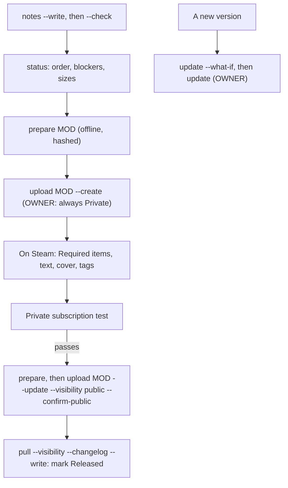

# Steam Workshop publishing

**Answer first.** `steam-publish` takes a repository's mods to the Steam Workshop: it turns each mod's changelog
into Steam change notes, checks the Workshop page, stages a hashed candidate offline, uploads it through Valve's
SteamCMD when the owner runs it, records what went up, and brings Steam's live state back. It came from
phobos-ostranauts' publishing scripts (owner's request, 8 November 2026), made to work for any game with an adapter:
RimWorld and Ostranauts so far.

## Read this first (gotchas)

- **Only the owner uploads.** `upload` and `update` start SteamCMD, which asks for the Steam password and Steam Guard
  code in its own prompt; the tool never sees, stores or passes them. Agents, tests and CI never run a real upload.
  Every other command is offline or reads Steam's public API without a key.
- **New items are always created Private.** Test a private subscription, then update with `--visibility public
  --confirm-public`. Anything wider than Private needs a candidate prepared from committed work.
- **Never retry a create blindly.** If SteamCMD returns no item ID, check your Workshop items on Steam first, then
  `reconcile` the receipt with `--item-id` or `--not-created`. The tool refuses a second create until you do.
- **SteamCMD cannot set Required items.** Add them on the item's page (Owner controls, Add/Remove Required Items);
  the uploader prints the list.
- **RimWorld: SteamCMD sets no tags.** RimWorld's own uploader tags an item "Mod" and with each game version (such as
  1.7); after a SteamCMD upload, check the tags. Source: a
  [Ludeon forum report](https://ludeon.com/forums/index.php?msg=337218), not checked against Valve's documentation.
- **RimWorld: About/PublishedFileId.txt must agree with the catalogue.** The game's own uploader writes it; the tool
  writes it too when it records a new item, and refuses to work while the two disagree, so one mod never becomes
  two items.
- **Workshop text may not hold ASCII double quotes or backslashes.** It travels inside a SteamCMD file whose escapes
  Valve does not document. Changelog quotes become typographic ones; pages must use them already.
- **Pages stay under 7,500 bytes** (our headroom; Steam's limit is 8,000), and a change note longer than Steam's
  limit drops its oldest versions and names them in a closing line.
- **Not tested against Steam from this kit yet.** The logic was carried over from phobos-ostranauts, whose
  PowerShell uploader (asked for by the owner on 29 September 2026) put its ten items on the Workshop, and checked
  against that repository's records (see "Checked" below). The Python uploader itself has run only against a
  stand-in for SteamCMD.

## The flow



## Commands

Run from the repository, or pass `--root`. A game repository normally calls these through a thin wrapper script.

```text
python -m phobos_modkit steam-publish notes --check           release notes current? pages valid?
python -m phobos_modkit steam-publish notes --write           write workshop/<Mod>/releases/<version>.bbcode
python -m phobos_modkit steam-publish notes --check --base origin/main   content changes came with their records?
python -m phobos_modkit steam-publish status                  every mod: package, blockers, sizes, order
python -m phobos_modkit steam-publish pending                 which items have a newer version than uploaded
python -m phobos_modkit steam-publish prepare Framework [--build]
python -m phobos_modkit steam-publish verify <candidate folder>
python -m phobos_modkit steam-publish upload Framework --create [--what-if]          OWNER ONLY
python -m phobos_modkit steam-publish upload Framework --update [--visibility public --confirm-public]
python -m phobos_modkit steam-publish update [--what-if] [--no-build] [--acknowledge-hold]   OWNER ONLY
python -m phobos_modkit steam-publish reconcile <receipt folder> --item-id 123 | --not-created
python -m phobos_modkit steam-publish pull [--visibility] [--description] [--changelog] [--write]
python -m phobos_modkit steam-publish change-notes [--no-write]
```

Mods are named in full or by a unique ending, ignoring case: `Framework` for `PhobosFramework`. `--json` gives JSON.

| Command | Writes | Reaches Steam |
| --- | --- | --- |
| `notes` | Generated change notes, only with `--write` | No |
| `status`, `pending`, `verify` | Nothing | No |
| `prepare` | A new candidate in the staging folder | No |
| `upload`, `update` | Receipt, catalogue records, RimWorld's ID file | **Yes, through SteamCMD, owner only** |
| `reconcile` | The receipt and catalogue records | No |
| `pull` | Catalogue, page and changelog, only with `--write` | Public API, no key |
| `change-notes` | Worksheets in `.local/workshop-change-notes/` | No |

### Release notes

Changelogs follow the [Phobos form](release.md#changelogs): an Unreleased section, then
`## [1.2.0] - 2026-11-08 - Draft` or `Released` entries. Each entry becomes
`[h1]<title> <version>[/h1]`, a status line and its body in BBCode. The Markdown kept is paragraphs, dash (`-`) bullets
(hard-wrapped lines join them), `###` headings, `**bold**` and `[label](https://...)` links; anything else is
refused rather than lost. Generated files are never edited by hand.

A page needs `[h1]<title>[/h1]`, one `[b]Version:[/b] <version>` line and a `[b]Publication status:[/b] ...` line
(each can be switched off with `pageRules`). `--base <commit>` also refuses content changed since that commit without
both a changelog and a page edit.

### Preparing

`prepare` runs every check, then writes a fresh folder (older ones are kept) holding `content/` (what the item will
hold), the page and change note, `workshop.vdf.draft` and `manifest.json` with each file's SHA-256 hash, the version,
commit, blockers and text sizes. Candidates live in the kit's cache folder, outside a cloud-synced repository.

Blockers: a catalogue `hold`, a missing or oversized cover, and a dependency with no item yet. A Private upload with
`--acknowledge-hold` may pass a hold or an unpublished dependency, for the owner's own test; a missing cover never.

The change note holds every changelog version after the item's `uploadedVersion`, newest first, so versions never
uploaded on their own still reach players. A first upload carries its own version only.

### Uploading (owner only)

Install [Valve's SteamCMD](https://developer.valvesoftware.com/wiki/SteamCMD) yourself; the account must own the
game. Pass `--steamcmd` and `--steam-user` once: they are remembered in `.local/workshop-settings.json`, never a
password. `PHOBOS_STEAMCMD` also names the program.

In order, `upload`:

1. For an update, stops when this version is already on the item with this visibility (`--force` sends it again).
2. Takes the newest candidate (or `--candidate`), re-checks every hash, and checks it matches the source version,
   the catalogue's item ID, the last uploaded version and the operation.
3. Applies the rules: blockers, Private-only creation, committed work for wider visibility, `--confirm-public` when
   an item first goes public, no second create while one is unresolved.
4. Writes `upload.vdf` and `receipt.json` under `.local/workshop-receipts/<Mod>/` **before** SteamCMD starts. A public
   upload sends "Not published" status lines as public and Draft headings as Released on the day; the repository is
   untouched until you record it.
5. Runs `steamcmd +login <account> +workshop_build_item <file> +quit` in your console and keeps its fresh logs.
6. Records the item ID SteamCMD wrote back (a create), and the version and visibility sent, in the catalogue: commit
   it. A failed update records nothing, so its versions are described again next time.

SteamCMD's exit code is not proof: receipts end `created-unverified` or `submitted-unverified`. Open the item and
check it. `update` does all of this for every item whose mod has a newer version, dependencies first, building each
with the catalogue's `build` command unless `--no-build`, and stops at the first failure.

### Pulling from Steam

`pull` reads Valve's
[GetPublishedFileDetails](https://partner.steamgames.com/doc/webapi/ISteamRemoteStorage#GetPublishedFileDetails)
without a key: `--visibility` records the item's live visibility, `--description` replaces the page with the live
text (never when Steam shows another version), and `--changelog` marks a public item's uploaded version Released,
dated by Steam's last update in local time, and writes its notes again. Private and friends-only items read as not
found and are left alone.

### Tidying change notes

Steam has no tool route to edit or delete a change note: [ISteamUGC](https://partner.steamgames.com/doc/api/ISteamUGC)
and SteamCMD only add one per upload. `change-notes` rebuilds each item's entries from the receipts and writes a
worksheet: an entry repeating a version gets a one-line pointer, and a Draft heading on a now-public item becomes
Released or Uploaded privately. Paste the text into the item's Change Notes tab. Receipts live only in the checkout
that uploaded.

## The catalogue

`config/workshop-publishing.json` lists every mod; the tool refuses a catalogue that misses one.

```json
{
  "appId": "294100",
  "layout": {"exclude": ["*.record.md"], "build": ["python", "scripts/deploy.py", "--build"]},
  "mods": {
    "PhobosFramework": {"itemId": null, "requires": [], "hold": null},
    "PhobosMedical": {"itemId": "3900000000", "requires": ["PhobosFramework"],
                      "hold": "Held: awaiting play checks", "uploadedVersion": "0.7.0", "uploadedVisibility": "private"}
  },
  "externalRequiredItems": ["1000000001"],
  "externalRequiredItemNames": {"1000000001": "Someone's loader (a made-up example)"}
}
```

`appId` chooses the game adapter. `itemId`, `uploadedVersion` and `uploadedVisibility` are written by the tools from
what Steam returned; never invent one. A mod may carry its own `build` command.

| Layout key | Default | What it is |
| --- | --- | --- |
| `mod` | `mods/{mod}` | The mod's source folder; the adapter reads its metadata there |
| `changelog` | `mods/{mod}/CHANGELOG.md` | |
| `page` | `workshop/{mod}/page.bbcode` | The Workshop description |
| `releases` | `workshop/{mod}/releases` | Generated change notes |
| `content` | `mods/{mod}` | The folder uploaded, unless the repository passes its own payload |
| `exclude` | none | Globs left out of the content, by path or file name |
| `preview` | the adapter's | The cover, inside the content |
| `textFolder` | none | A content folder to carry the page and change note (Ostranauts used `documentation`) |
| `scope` | `mods/{mod}/` | Changes here need changelog and page edits (`notes --base`) |
| `dirtyExempt` | none | Folders whose uncommitted changes do not block a wider upload; the catalogue always is |
| `receipts`, `settings`, `worksheets` | under `.local/` | Owner records; keep receipts |
| `staging` | the kit's cache | Where candidates go |
| `pageMaxBytes`, `previewMaxBytes` | 7,500 and 1,000,000 | Our budgets, not Valve figures |
| `pageRules` | all on | `title`, `version`, `status` lines required on the page |
| `build` | none | A command run before preparing, `{mod}` replaced |

## Game adapters

| Game | App | Title and version | Cover | Also |
| --- | --- | --- | --- | --- |
| RimWorld | 294100 | `About/About.xml` `<name>`, `<modVersion>` | `About/Preview.png` | Keeps `About/PublishedFileId.txt` in step; reminds about tags |
| Ostranauts | 1022980 | `mod_info.json` `strName`, `strModVersion` | `preview.png` | |

What a package must hold beyond its folder is the repository's policy, not the game's format. A wrapper passes it as
a payload hook, `payload(project, mod) -> {relative path: bytes}`, which may also raise on a stale build:

```python
from phobos_modkit.steam.publish.cli import main
sys.exit(main(root=ROOT, settings_file=SETTINGS, payload=my_package_checks))
```

## Adopting it

- **phobos-rimworld:** its AGENTS.md adopts publication tooling in the change that prepares the first mod for its
  public beta gate, not before. Then: a catalogue with `"appId": "294100"`, a `workshop/<Mod>/page.bbcode` per mod, a
  wrapper script, `exclude` for files that should not ship (asset records), and a rule in its AGENTS.md. Its
  changelogs already pass `release changelog`, except one bracket in D'thorga Factory Additions 0.11.0 (8 November 2026).
- **phobos-ostranauts:** when it next touches its publishing scripts. Its catalogue needs `layout` entries to keep
  its behaviour: `scope` of `src/{mod}/`, `mods/{mod}/` and `translations/{mod}/`; `dirtyExempt` of `docs/research/`
  and `docs/development/`; `textFolder` of `documentation`; and its package checks (the `dist/` package, plugin DLLs
  against compiled output, read-only data headers, sounds, translations) as a payload hook. See
  [migration](migration.md) for every difference.

## Checked (8 November 2026)

Run read-only against phobos-ostranauts, whose scripts made its real uploads, and compared with those scripts:

| Check | Result |
| --- | --- |
| Release notes for 444 changelog entries | Byte for byte the same as the committed files |
| Due updates (`pending`) | Same 5 of 10 items |
| Combined change notes, all 10 mods, plus three far-back starting versions that need versions cut | Byte for byte the same |
| Change-note worksheets from its real receipts | Same counts for all 10 items |
| `pull` against Steam's public API | Same findings for all 10 items |
| 149 registered constants | All verified |

Tests (`tests/test_steam_publish.py` and the `test_release_*` files) build made-up repositories in temporary folders
and use stand-ins for SteamCMD and Steam's API. None of this is an upload test.
